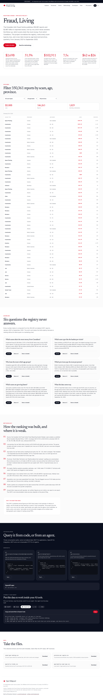
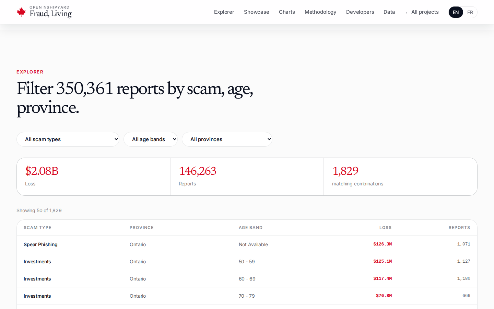
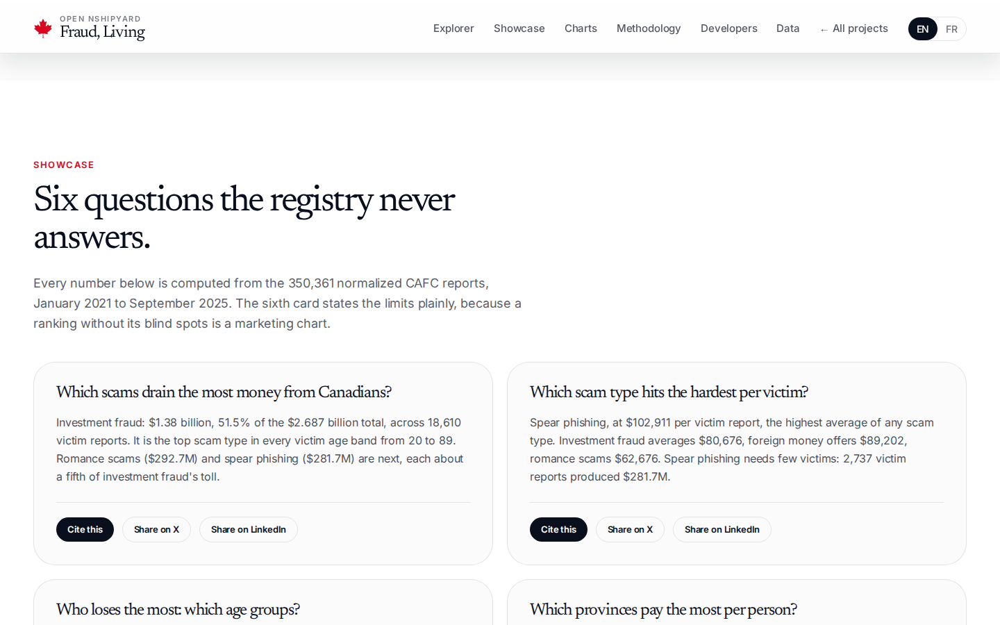
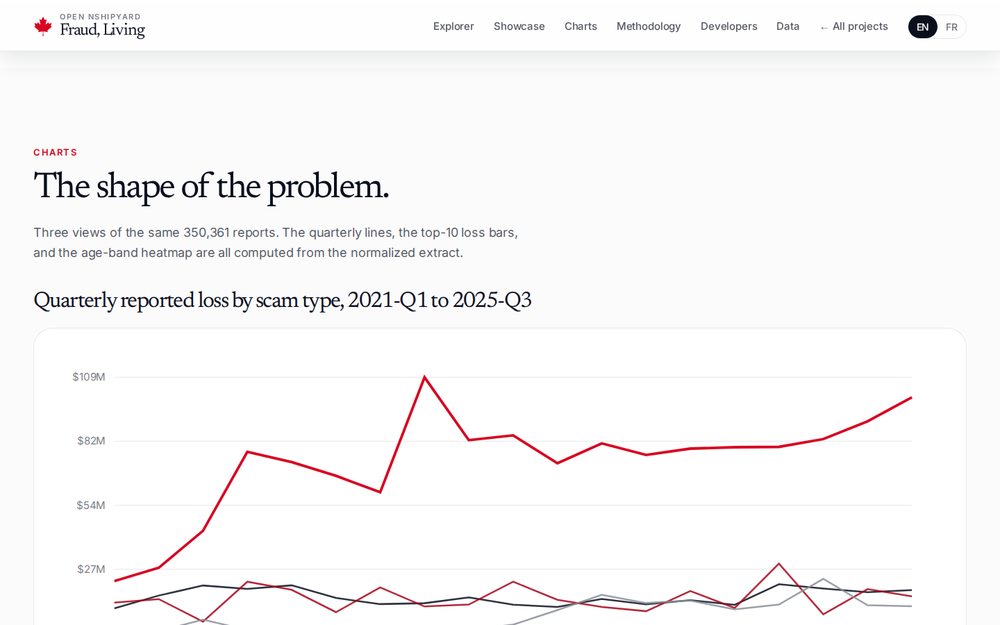
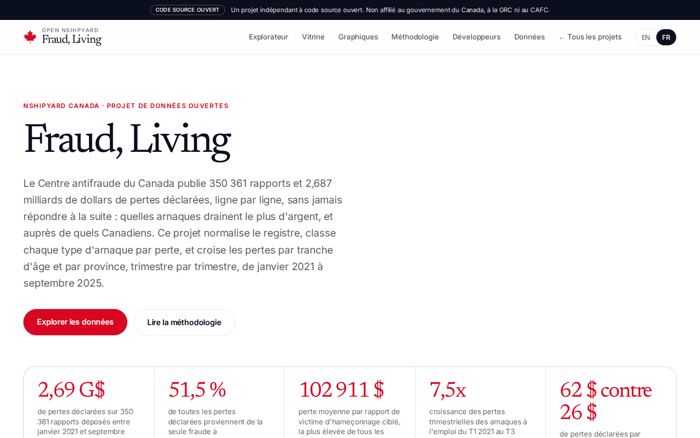
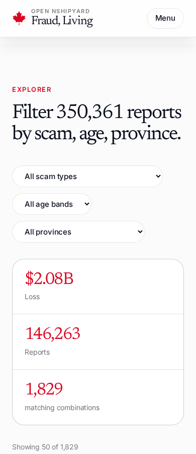

# Fraud Losses, Tracked

The Canadian Anti-Fraud Centre publishes 350,361 reports and $2.687 billion in reported losses, row by row, and it never answers the follow-up: which scams drain the most money, from which Canadians. This project normalizes the registry, ranks every scam type by loss, and cross-tabs losses by age band and province, quarterly, from January 2021 to September 2025.

**Planned domain:** fraud.canada.nshipyard.com
**Source vintage:** extract 2025-10-01, coverage 2021-01-01 to 2025-09-30. **Retrieved:** 2026-10-10.

## What it is

An open-source web app (Next.js 16, EN/FR) over the CAFC Fraud Reporting System Dataset. Sections: hero with 5 stat cards, a filterable explorer of 1,829 precomputed scam-type, province, and age-band slices, a 6-card showcase of questions the registry never answers, 3 hand-built SVG charts (quarterly trend lines, top-10 loss bars, age-band heatmap), full methodology, REST + OpenAPI + MCP developer docs, and CSV downloads.

## Three headline findings

1. **Investment fraud is 51.5% of all reported losses.** $1.382B across 18,610 victim reports, and the top scam type in every victim age band from 20 to 89.
2. **Spear phishing hits the hardest per victim: $102,911 per victim report**, the highest average of any scam type. 2,737 victim reports produced $281.7M. Job scams are the fastest-growing: quarterly losses up 7.5x from Q1 2021 to Q3 2025.
3. **British Columbia and Ontario lose $62 per person to fraud, Quebec $26.** Canadians aged 60 to 69 lost $429M, more than any other age band. Honest gaps: 37.7% of losses carry no victim age, 19.9% no province.

## Data sources and vintage

- **Source:** Canadian Anti-Fraud Centre Fraud Reporting System Dataset, open.canada.ca, publisher Royal Canadian Mounted Police / CAFC. 75.5 MB CSV, 350,361 rows, extracted 2025-10-01.
- **Population:** StatCan quarterly population estimates, July 1 2026, table 17-10-0009-01.
- **Files:** `public/data/*.json` (computed aggregates: meta, category_ranking, age_heatmap, province_ranking, trends, methods, slices), `public/data/downloads/*.csv` (scam-type-ranking, province-per-capita, quarterly-trends, age-band-by-scam-type).
- **Build script:** `scripts/build_data.py`.

## API

- `GET /api/v1/summary` - headline aggregates (total loss, counts, top scam type, top per-capita province)
- `GET /api/v1/explore?category=&province=&age=` - 1,829 precomputed slices, filterable by facet (limit 50 default, 200 max)
- `GET /api/v1/ranking?limit=` - 39 scam types ranked by reported loss
- `GET /api/v1/provinces` - 13 provinces and territories by loss per person
- `GET /api/v1/trends?categories=` - quarterly loss series 2021-Q1 to 2025-Q3
- `GET /api/v1/heatmap` - 9 age bands by top 12 scam types
- `GET /api/v1/methods` - solicitation methods by loss
- `GET /api/openapi.json` - OpenAPI 3.1 spec
- `POST /mcp` - streamable-HTTP MCP: `fraud_lookup`, `scam_ranking`, `trend`

## Screenshots

## Honest limits

- 37.7% of reported losses carry no victim age; 19.9% carry no province. Age and province views are floors, not totals.
- Geographic grain is province only. No city-level view is possible from this data.
- All $2.687B comes from rows marked Victim. Attempt rows carry $0 in this extract.
- Losses are self-reported, not independently verified. Reports are not victims.
- The data stops at September 30, 2025.

## Author

Built by [Richardson Dackam](https://x.com/richardsondx) · [github.com/richardsondx](https://github.com/richardsondx)

An independent open-source project. Not affiliated with the Government of Canada, the RCMP, or the CAFC.
